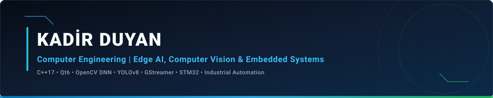

<!-- ÖZEL MÜHENDİSLİK BAŞLIK GÖRSELİ (REPO İÇİ SVG BANNER - %100 ÇALIŞIR) -->

 

<!-- HIZLI ERİŞİM BUTONLARI -->

  
  &nbsp;
  
  &nbsp;
  

---

## ⚡ Mühendislik Profili & Kurumsal Özet

Gerçek zamanlı **Bilgisayarlı Görü (Edge AI / Computer Vision)** boru hatları, **Endüstriyel Otomasyon & HMI (Qt6 C++)** yazılımları ve **Gömülü Sistemler (STM32 / Mikrodenetleyici Donanım-Yazılım Entegrasyonu)** alanlarında düşük gecikmeli, uçtan uca mühendislik çözümleri geliştiriyorum.

- 🎓 **Eğitim:** **Sakarya Üniversitesi** — Bilgisayar Mühendisliği *(4. Sınıf)*
- 🏭 **Mühendislik Deneyimi — EPROM Elektronik San. Tic. A.Ş.:**
  - **Edge AI & Computer Vision Mühendislik Stajı:** `Qt6 C++`, `GStreamer`, `OpenCV DNN` ve `YOLOv8` tabanlı gerçek zamanlı çoklu kamera görüntü işleme ve nesne takip mimarilerinin geliştirilmesi.
  - **Gömülü Sistemler (Embedded Systems) Mühendislik Stajı:** `STM32` mikrodenetleyicileri, kesme (interrupt) tabanlı gerçek zamanlı sensör-aktüatör kontrolü ve donanım-yazılım haberleşme protokollerinin entegrasyonu.
- 🏆 **Başarı & Ödül:** **GreyDec 2026 Savunma Sistemleri Ideathonu Şampiyonu (1.'lik Ödülü)** — *Savunma teknolojileri ve otonom karar destek sistemleri alanında birincilik.*

---

## 🛠️ Teknoloji Yığını (Tech Stack)

### 💻 Programlama Dilleri

  
  
  
  
  

### 👁️ Edge AI, Bilgisayarlı Görü & Endüstriyel Arayüz (HMI)

  
  
  
  

### 🔌 Gömülü Sistemler & Donanım Otomasyonu

  
  
  
  

### ⚙️ Sistem, DevOps & Yapılandırma Araçları

  
  
  
  

---

## 🚀 Öne Çıkan Mühendislik Projeleri (Featured Repositories)

| Proje | Odak Alanı & Mimari | Teknoloji Yığını |
| :--- | :--- | :--- |
| **[CapsuX-Industrial-Inspection](https://github.com/Kadirduyan/CapsuX-Industrial-Inspection)** | **Endüstriyel Kapsül Kalite Kontrol ve Otomasyon Sistemi:** Gerçek zamanlı bilgisayarlı görü (AI Heatmap) ile donanım kesmeli (`TCRT5000 FALLING Interrupt`) ve `SG90` servo ayırmalı düşük gecikmeli kontrol paneli. | `C++17` `Qt6` `QSerialPort` `YOLOv8` `Arduino` `CMake` |
| **[FARMEYE-AI](https://github.com/Kadirduyan/FARMEYE-AI)** | **Gerçek Zamanlı Çoklu Kamera Tarım & Çiftlik İzleme Platformu:** `GStreamer` (`RTSP` + `D3D11` GPU Decode), `YOLOv8n` nesne tespiti ve `ByteTrack` çoklu nesne takibi içeren OpenGL hızlandırmalı masaüstü sistemi. | `C++17` `Qt6 OpenGL` `GStreamer` `OpenCV DNN` `YOLOv8` `ByteTrack` |
| **[IoT-Based-Smart-Door-Lock-System](https://github.com/Kadirduyan/IoT-Based-Smart-Door-Lock-System)** | **Kablosuz Akıllı Kapı Kilidi ve Erişim Kontrol Sistemi:** `NodeMCU (ESP8266)` Wi-Fi haberleşmesi, `LM2596` step-down güç regülasyonu ve `12V` elektromekanik solenoid kilit otomasyonu. | `Embedded C` `ESP8266` `IoT` `Power Electronics` `LM2596` |
| **[FitnessCenter](https://github.com/Kadirduyan/FitnessCenter)** | **Yapay Zeka Destekli Spor Salonu Yönetim ve Randevu Sistemi:** `ASP.NET Core Identity` rol yetkilendirme (`Admin`/`Member`), `LINQ` filtreli REST API ve `OpenAI API` egzersiz/diyet öneri motoru. | `C#` `ASP.NET Core 9.0` `EF Core` `SQL Server` `OpenAI API` |
| **[vtysproje](https://github.com/Kadirduyan/vtysproje)** | **Hastane Yönetim ve Otomasyon Sistemi (VTYS):** Normalleştirilmiş `PostgreSQL` ilişkisel veritabanı, saklı yordamlar, tetikleyiciler (`Triggers`) ve `Npgsql` tabanlı çoklu form masaüstü uygulaması. | `C#` `.NET WinForms` `PostgreSQL` `Npgsql` `PL/pgSQL` |
| **[KadirDuyan-Personal](https://github.com/Kadirduyan/KadirDuyan-Personal)** | **Kişisel Web Portföyü ve Kültür Portalı:** Duyarlı (responsive) ön yüz mimarisi, harici REST API entegrasyonu ve PHP tabanlı oturum/form doğrulama modülleri. | `HTML5` `CSS3` `JavaScript` `PHP` `Bootstrap` |

---

## 📊 GitHub İstatistikleri & Geliştirici Analitiği

  
  

  

---

### 📫 İletişim & Bağlantılar

&nbsp;

